# E-Bank : application bancaire en microservices avec assistant IA

Projet du module **Systèmes distribués**, réalisé par **Fahd Krachel**.

L'application gère des clients et des comptes bancaires à travers plusieurs microservices (Spring Boot / Spring Cloud). Un **assistant conversationnel** (Spring AI + GPT-4o) interroge ces services grâce au protocole **MCP** (Model Context Protocol), et il est joignable depuis une interface web **Angular** et depuis **Discord**.

---

## 1. Architecture

### Architecture 

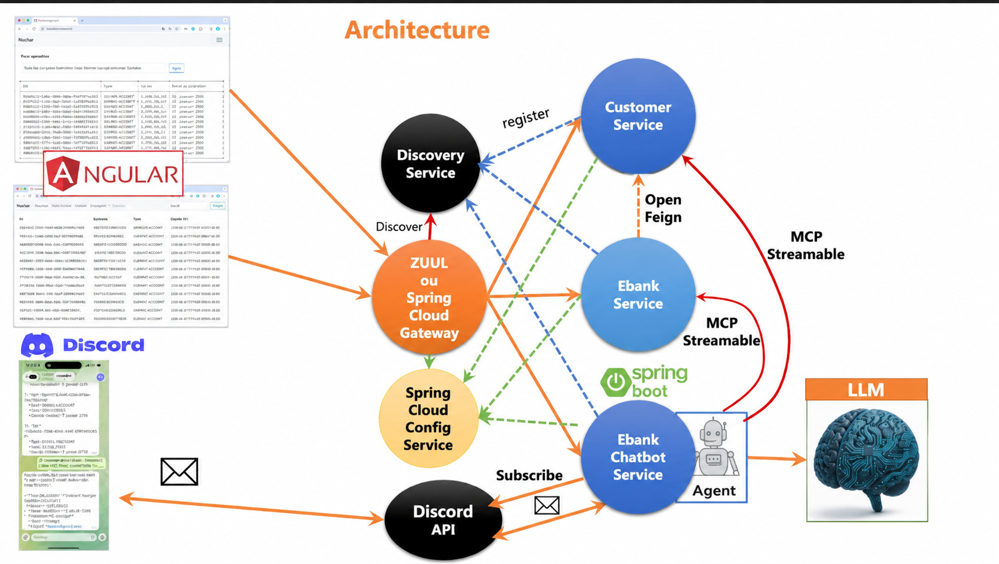

> Ce schéma décrit l'architecture de référence. 


| Service | Port | Rôle |
|---|---|---|
| `discovery-service` | 8761 | Annuaire de services (Eureka) |
| `Gateway-service` | 9999 | Point d'entrée unique, routage (statique ou dynamique via Eureka), CORS |
| `customer-service` | 8056 | Gestion des clients (base H2) |
| `ebank-service` | 8057 | Gestion des comptes bancaires, appelle `customer-service` via OpenFeign |
| `ebank-bot` | 8058 | Assistant IA (chat, streaming, bot Discord) |
| `angular-front` | 4200 | Interface web |

## 2. Technologies

Java, Spring Boot 4, Spring Cloud (Eureka, Gateway, OpenFeign), Resilience4j, Spring Data JPA, H2, Spring AI, OpenAI GPT-4o, MCP (Streamable HTTP), Swagger / OpenAPI, Angular, Bootstrap, Maven.

---

## 3. Réalisation et tests

### 3.1 Service de découverte (Eureka)

Le `discovery-service` est créé et démarré sur le port 8761. Au départ, aucun service n'est enregistré.

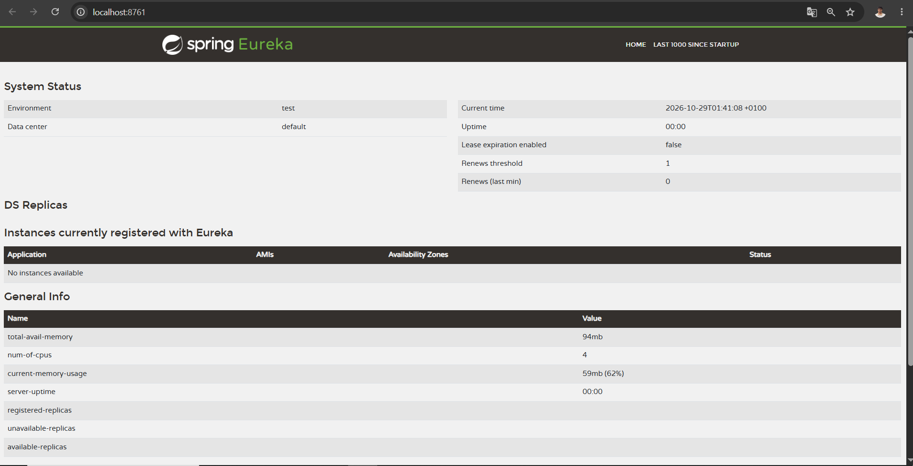

Après l'activation de la découverte dans les propriétés de chaque microservice, `CUSTOMER-SERVICE`, `EBANK-SERVICE` et `GATEWAY-SERVICE` s'enregistrent automatiquement et apparaissent avec le statut **UP**.

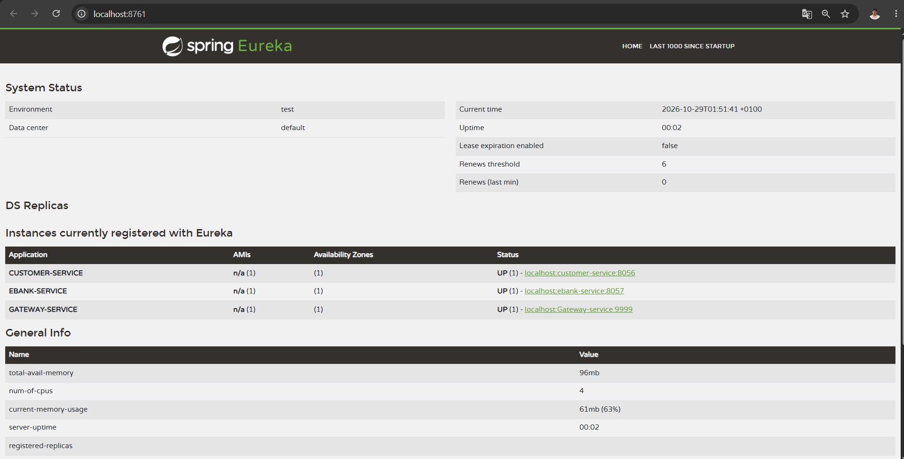

### 3.2 customer-service

Le service expose trois endpoints, documentés avec Swagger (`http://localhost:8056/swagger-ui/index.html`).

| Méthode | Route | Description |
|---|---|---|
| GET | `/customers` | Liste des clients |
| POST | `/customers` | Création d'un client |
| GET | `/customers/{id}` | Détail d'un client |

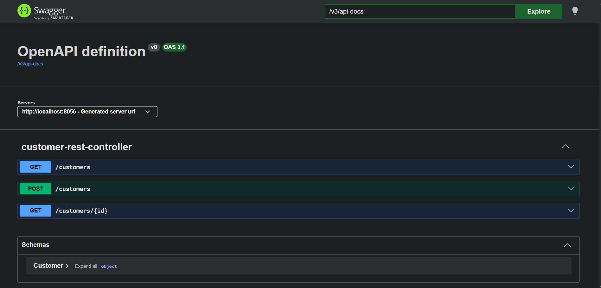

Test de `GET /customers` : les trois clients de test sont retournés.

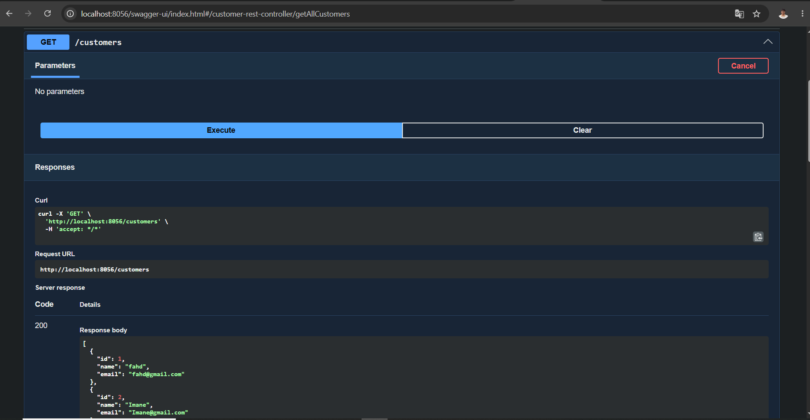

### 3.3 ebank-service

Le service expose les endpoints `GET /accounts`, `GET /accounts/{id}` et `POST /accounts` (`http://localhost:8057/swagger-ui/index.html`).

Test de `GET /accounts` :

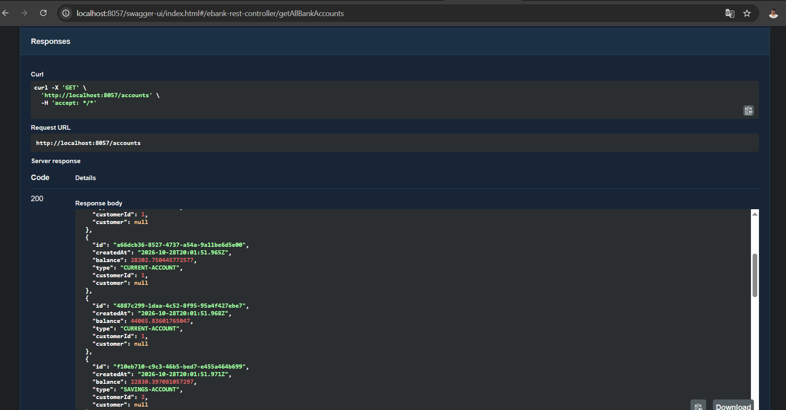

Test de `POST /accounts` : création d'un compte courant pour le client n°2. Un identifiant et une date de création sont générés automatiquement.

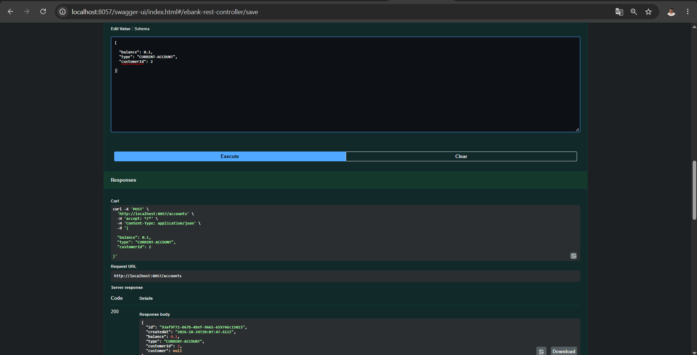

### 3.4 Communication inter-services avec OpenFeign

`ebank-service` interroge `customer-service` grâce à un client **OpenFeign**, sans connaître son adresse : le nom logique `customer-service` est résolu via Eureka. Le détail d'un compte contient donc les informations complètes du client propriétaire.

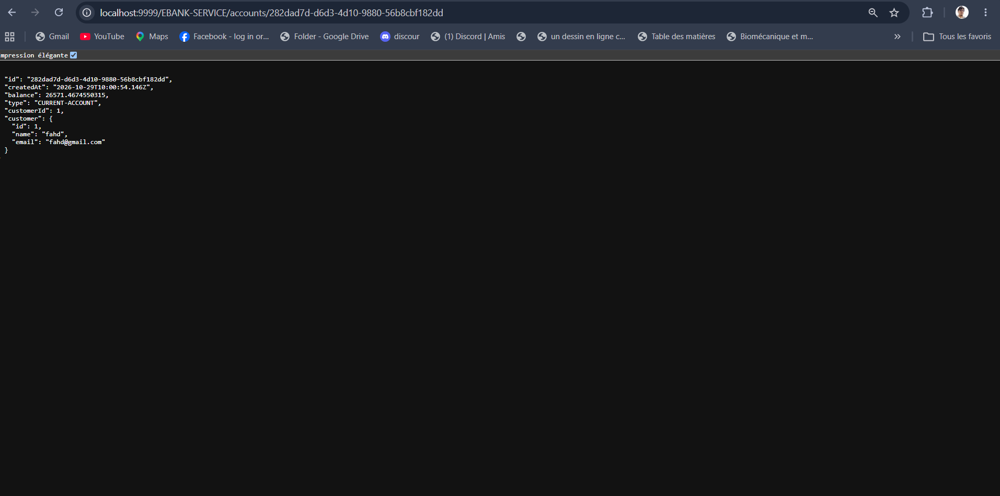

### 3.5 Gateway

La Gateway est le point d'entrée unique de l'application (port 9999). Deux modes de routage ont été testés.

**Routage statique** : les routes sont déclarées une par une dans un fichier de configuration (`/customers/**` vers `customer-service`).

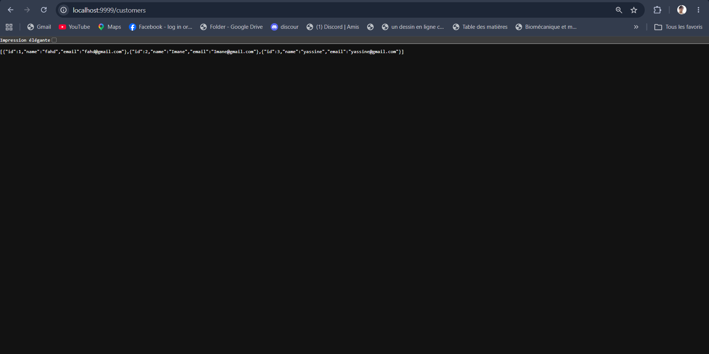

**Routage dynamique** : la Gateway utilise Eureka pour découvrir les services et crée les routes automatiquement. Le nom du service sert de préfixe dans l'URL : `/CUSTOMER-SERVICE/**`, `/EBANK-SERVICE/**`, `/EBANK-BOT/**`.

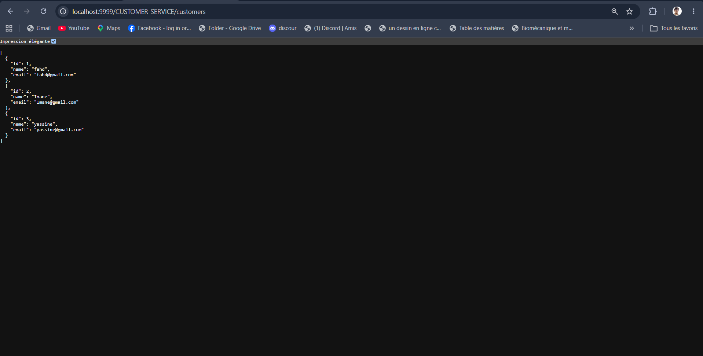

### 3.6 Tolérance aux pannes avec Resilience4j

Un **circuit breaker** protège l'appel de `ebank-service` vers `customer-service`. Si `customer-service` est arrêté, la méthode de repli (*fallback*) renvoie un client par défaut au lieu de provoquer une erreur : l'application continue de répondre.

Test réalisé avec `customer-service` arrêté : le compte est retourné avec un client par défaut (`default customer name`).

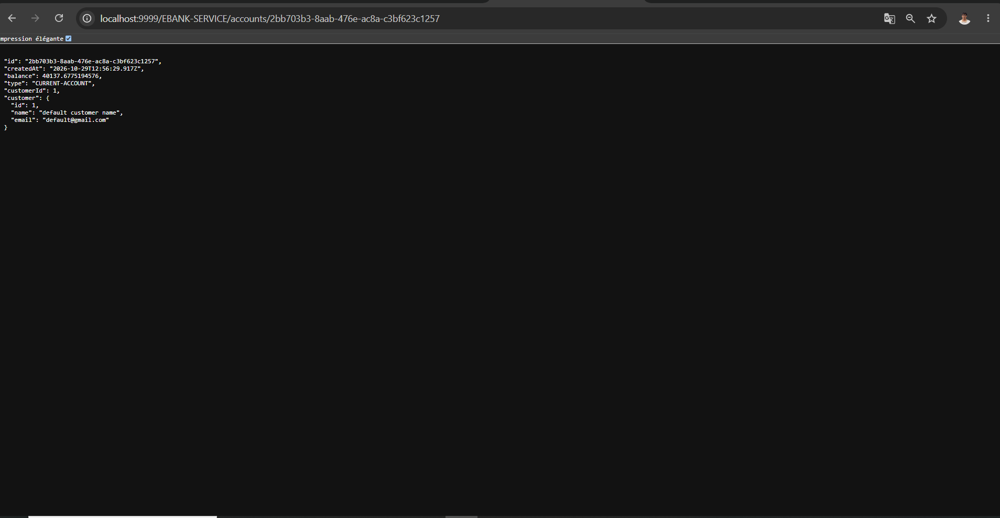

### 3.7 Assistant IA (Spring AI + MCP)

Le bot `ebank-bot` utilise GPT-4o. Les méthodes des deux services métier sont exposées comme **outils MCP** (`@McpTool`) : le modèle peut ainsi lister les clients, consulter ou créer des comptes en appelant directement les microservices. La mémoire de conversation est gérée par identifiant de conversation (`conversationId`).

| Méthode | Route | Description |
|---|---|---|
| GET | `/chat?query=...&conversationId=...` | Réponse complète |
| GET | `/chatStream?query=...&conversationId=...` | Réponse en streaming |

Test du endpoint `/chat` via Swagger (`http://localhost:8058/swagger-ui/index.html`) :

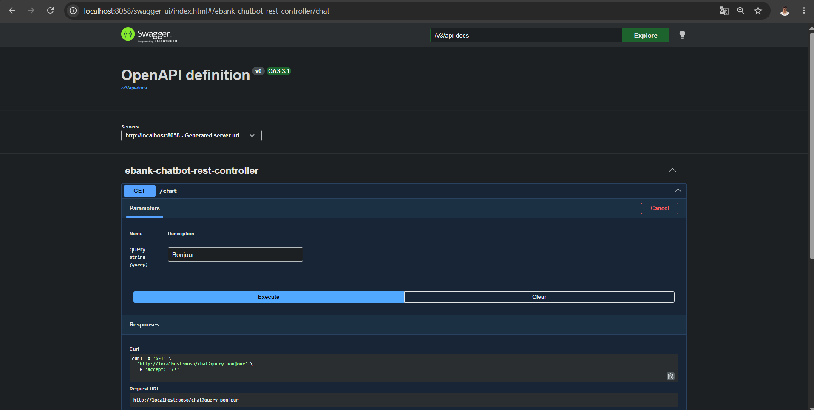

### 3.8 Intégration Discord

Le bot est également accessible depuis Discord. Dans cet exemple, la demande « liste des clients » déclenche un appel MCP vers `customer-service`, et le bot présente les résultats.

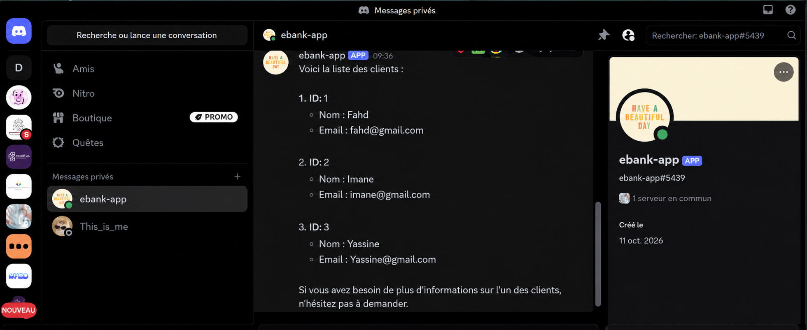

### 3.9 Interface web Angular

Le frontend Angular (port 4200) communique uniquement avec la Gateway. Il propose deux pages, accessibles depuis la barre de navigation.

**Page « Comptes »** : liste des comptes bancaires récupérée via `http://localhost:9999/EBANK-SERVICE/accounts` (identifiant, solde, date de création, type de compte et client).

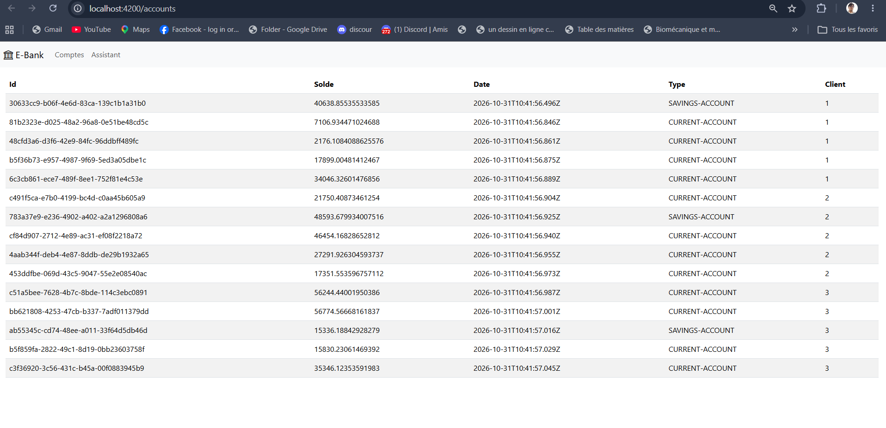

**Page « Assistant »** : champ de saisie pour dialoguer avec l'assistant IA. Le bouton d'envoi affiche la réponse complète, et le bouton éclair affiche la réponse en streaming. Chaque session possède son propre identifiant de conversation.

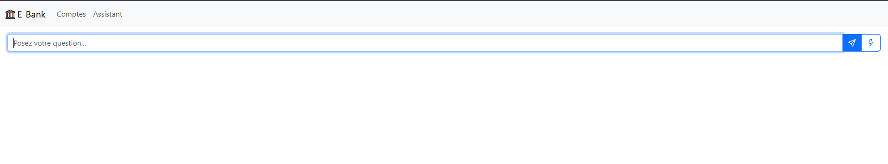

---

## 4. Configuration

Les secrets ne sont jamais écrits dans le code. Définissez-les sous forme de variables d'environnement avant de lancer `ebank-bot` :

```bash
OPENAI_API_KEY=<votre-clé-openai>
DISCORD_TOKEN=<votre-token-discord>  
```

## 5. Lancer le projet

Ordre de démarrage :

1. `discovery-service`
2. `customer-service`
3. `ebank-service`
4. `Gateway-service`
5. `ebank-bot`
6. Frontend :
   ```bash
   cd angular-front
   npm install
   ng serve
   ```

Avec Maven, dans chaque dossier de service : `./mvnw spring-boot:run`

| Adresse | Contenu |
|---|---|
| http://localhost:8761 | Tableau de bord Eureka |
| http://localhost:9999/CUSTOMER-SERVICE/customers | Clients via la Gateway |
| http://localhost:9999/EBANK-SERVICE/accounts | Comptes via la Gateway |
| http://localhost:9999/EBANK-BOT/chat?query=Bonjour | Chat via la Gateway |
| http://localhost:4200 | Interface web |

## 6. Améliorations prévues

- Authentification et autorisation (Keycloak / JWT)
- Base de données persistante (PostgreSQL ou MySQL) à la place de H2
- Docker Compose pour lancer tous les services d'une commande
- Service de configuration centralisé (Spring Cloud Config)
- Validation des entrées et tests unitaires et d'intégration
